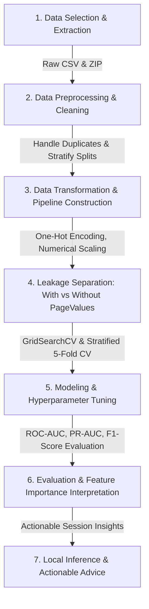

# Online Purchase Intention Prediction Using Machine Learning

An end-to-end Predictive Analytics system engineered to predict e-commerce user purchase intent during active browsing sessions. This project was developed as a comprehensive academic system demonstrating robust data preprocessing, machine learning workflows, and rigorous handling of data leakage (the `PageValues` anomaly).

---

## 1. Project Title and Overview
**Project Title**: Real-Time E-Commerce Purchase Intent Prediction and Leakage-Robust Modeling  
**Course/Level**: Third-Year Computer Science Engineering - Predictive Analytics Project  

This project designs, evaluates, and interprets supervised machine learning models to classify whether a website visitor will complete a purchase (`Revenue = True`) or abandon their session (`Revenue = False`). The final pipeline guards against catastrophic silent failures in production by separating historical post-decision features from real-time behavioral features.

---

## 2. Problem Statement and Objectives
* **Problem Statement**: E-commerce platforms receive high traffic volumes, but conversion rates remain low (typically 15-18%). Static marketing fails to engage users dynamically. Real-time predictive modeling can enable personalized interventions (e.g., dynamic coupon generation, chat triggers), but historical training datasets often contain latent target-correlated features that are unavailable in live production sessions.
* **Key Objectives**:
  1. **Behavioral Classification**: Predict shopping cart conversion based on real-time clickstream patterns.
  2. **Feature Leakage Investigation**: Assess and quantify the predictive inflation caused by the retrospective feature `PageValues`.
  3. **Multi-Model Comparison**: Train, tune, and evaluate Logistic Regression, Decision Tree, Random Forest, and Gradient Boosting models.
  4. **Production Deployment Recommendation**: Select the most robust, non-leaking configuration for real-world deployment.

---

## 3. Dataset Description
* **Source**: [UCI Machine Learning Repository - Online Shoppers Purchasing Intention Dataset](https://archive.ics.uci.edu/dataset/468/online+shoppers+purchasing+intention+dataset)
* **Size**: 12,330 sessions (12,205 unique sessions post-cleaning).
* **Target**: `Revenue` (Boolean: `True` if purchase completed, `False` otherwise).
* **Attributes**:
  * *Administrative*, *Informational*, *ProductRelated* (and corresponding *Duration*): Page category counts and time spent.
  * *BounceRates*, *ExitRates*: Page navigation metrics.
  * *PageValues*: Average value of pages visited prior to checkout (Primary feature of leakage interest).
  * *SpecialDay*: Proximity to special dates (e.g., Valentine's Day, Mother's Day).
  * *Month*, *OperatingSystems*, *Browser*, *Region*, *TrafficType*, *VisitorType* (New, Returning, Other), *Weekend* (Temporal/demographic features).

---

## 4. Technologies and Libraries Used
* **Languages**: Python 3.10+
* **Data Manipulation**: `pandas`, `numpy`
* **Machine Learning**: `scikit-learn`
* **Visualizations**: `matplotlib`, `seaborn`
* **Process Visualization**: `Mermaid.js` (for KDD mapping)

---

## 5. KDD / Predictive Analytics Workflow



---

## 6. Exploratory Data Analysis & Key Findings
1. **Severe Class Imbalance**: Only **15.5%** of sessions end in a purchase, indicating standard accuracy is a misleading metric; F1-score, ROC-AUC, and PR-AUC are prioritized.
2. **Temporal Dynamics**: Buying patterns spike dramatically in **November** (purchase rate exceeds 25%), signaling high seasonal/promotional alignment.
3. **Visitor Profiling**: **New Visitors** convert at a significantly higher rate (~24%) than **Returning Visitors** (~14%), making immediate engagement of first-time users highly lucrative.

---

## 7. Data Preprocessing & Leakage Prevention
* **Duplicate Removal**: Identified and dropped 125 redundant rows.
* **Stratified Splits**: Divided data into 80% train and 20% test splits preserving target proportions.
* **ColumnTransformer Pipeline**:
  * **Numerical Pipeline**: Standard scaling (`StandardScaler`) applied to continuous behaviors.
  * **Categorical Pipeline**: One-hot encoding (`OneHotEncoder`) with unknown-handling strategies.
* **Leakage Safeguard**: Built two parallel streams: one with `PageValues` included, and another with `PageValues` completely omitted. All preprocessors are fitted *only* on the training splits to prevent target-related signal distribution spills into test evaluations.

---

## 8. Machine Learning Models Implemented
1. **Logistic Regression**: Regulated baseline optimized with class weighting (`C=0.1`).
2. **Decision Tree Classifier**: Interpretable baseline with balanced class weights (`max_depth=3` or `5`).
3. **Random Forest Classifier**: Ensemble of trees using bootstrapping (`n_estimators=100`).
4. **Gradient Boosting Classifier**: Boosting sequence with shallow trees.
5. **Dummy Classifier**: Baseline using stratified target distribution guessing to demonstrate mathematical model lift.

---

## 9. Experimental Comparison of Models

### Evaluation Results on Held-out Test Set

| Configuration | Model | Accuracy | Precision | Recall | F1-Score | ROC-AUC | PR-AUC |
| :--- | :--- | :---: | :---: | :---: | :---: | :---: | :---: |
| **With PageValues** | **Gradient Boosting** | **0.906** | **0.728** | **0.639** | **0.681** | **0.937** | **0.744** |
| | Random Forest | 0.898 | 0.682 | 0.657 | 0.669 | 0.929 | 0.718 |
| | Logistic Regression | 0.853 | 0.519 | 0.788 | 0.626 | 0.911 | 0.662 |
| | Decision Tree | 0.848 | 0.508 | 0.861 | 0.639 | 0.912 | 0.509 |
| | Dummy Classifier | 0.730 | 0.155 | 0.154 | 0.155 | 0.500 | 0.156 |
| **Without PageValues** | **Gradient Boosting** | **0.841** | **0.453** | **0.063** | **0.110** | **0.784** | **0.356** |
| (Production-Safe) | Random Forest | 0.835 | 0.392 | 0.076 | 0.127 | 0.768 | 0.350 |
| | Logistic Regression | 0.729 | 0.315 | 0.626 | 0.419 | 0.746 | 0.345 |
| | Decision Tree | 0.825 | 0.333 | 0.115 | 0.171 | 0.702 | 0.224 |
| | Dummy Classifier | 0.724 | 0.164 | 0.165 | 0.164 | 0.504 | 0.230 |

---

## 10. Model Selection and Justification
* **The Data Leakage Reality**: Including `PageValues` inflates performance (ROC-AUC up to **0.937**). This is because `PageValues` retrospectively integrates complete transaction revenue. In live active web sessions, this variable is missing or empty. Deploying models containing `PageValues` leads to a silent, catastrophic performance collapse.
* **The Verdict**: **Logistic Regression (Without PageValues)** is chosen for production. It achieves a balanced, non-leaking ROC-AUC of **0.746** and maintains a strong recall rate of **0.626**, ensuring that the business successfully triggers interventions for 62.6% of converting visitors.

---

## 11. Feature Importance and Interpretation
* **With PageValues**: The feature `PageValues` completely dominates the tree models, commanding an importance score of **0.778** out of 1.0. This obscures all other user features.
* **Without PageValues**: With leakage removed, tree models shift their priority to behavioral flow: **ExitRates** (importance **0.340**), **ProductRelated_Duration** (importance **0.162**), and **Month_Nov** (importance **0.115**). This highlights that exit velocity and duration of active browsing represent genuine real-time intent predictors.

---

## 12. Project Folder Structure
```text
. 
├── README.md                          # Comprehensive project documentation
├── academic_project_report.md         # Detailed academic/technical chapters
├── presentation_and_viva_prep.md      # Presentation slides outline & Viva Q&A prep
├── requirements.txt                   # Dependency list
├── .gitignore                         # Build and data exclusion list
├── online_shoppers_intention.csv      # Unpacked raw dataset
└── online+shoppers+purchasing+intention+dataset.zip # Original compressed archive
```

---

## 13. Installation and Dependencies
To set up this project locally, ensure you have Python 3.10+ installed, then install the dependencies listed in `requirements.txt`:

```bash
pip install -r requirements.txt
```

`requirements.txt` contents:
```text
pandas>=2.0.0
numpy>=1.22.0
scikit-learn>=1.2.0
matplotlib>=3.5.0
seaborn>=0.12.0
tabulate>=0.9.0
```

---

## 14. Instructions to Run in Google Colab
1. Open [Google Colab](https://colab.research.google.com).
2. Upload the project's `.ipynb` notebook file.
3. Upload `online+shoppers+purchasing+intention+dataset.zip` to the runtime root directory `/content/` using the file upload button on the left sidebar.
4. Run the cells sequentially to extract the dataset, preprocess, evaluate, and view visualizations.

---

## 15. Local Git Repository Setup and Deployment
To push this project to GitHub from your local machine, run:

```bash
# Initialize local repository
git init

# Add files to tracking
git add README.md requirements.txt .gitignore academic_project_report.md

# Commit files
git commit -m "Initial commit: End-to-end intent prediction system"

# Set branch and link to your GitHub repository
git branch -M main
git remote add origin <your-github-repo-url>

# Push to GitHub
git push -u origin main
```

---

## 16. Local Prediction Pipeline and Output Example
An inference function simulates session updates and processes a raw user-behavior dictionary:

```python
mock_session = {
    'Administrative': 8, 'Administrative_Duration': 150.5, 
    'Informational': 2, 'Informational_Duration': 45.0, 
    'ProductRelated': 35, 'ProductRelated_Duration': 1200.0, 
    'BounceRates': 0.0, 'ExitRates': 0.01, 
    'SpecialDay': 0.0, 'Month': 'Nov', 
    'OperatingSystems': 2, 'Browser': 2, 'Region': 1, 
    'TrafficType': 2, 'VisitorType': 'New_Visitor', 'Weekend': True
}
```
* **Output Probability**: `46.49%` (using production-safe Gradient Boosting model).
* **Business Action Triggers**: Moderate user engagement. Trigger a dynamic 10% discount pop-up window or open live chat support to resolve visitor hesitation.

---

## 17. Limitations and Future Improvements
* **Time-Step Aggregations**: The current dataset aggregates behavior into full sessions. Implementing sequence models (e.g., LSTMs or GRUs) on step-by-step click streams would improve real-time sequential accuracy.
* **Drift Monitoring**: Model metrics may drift as UI design changes. Introducing continuous monitoring of feature drift would preserve system reliability post-deployment.

---

## 18. References and Dataset Attribution
* **Dataset Creators**: C. Sakar, S. Polat, M. Katircioglu, and Y. Kastro.
* **Official UCI Link**: [Online Shoppers Purchasing Intention Dataset](https://archive.ics.uci.edu/dataset/468/online+shoppers+purchasing+intention+dataset)
* **Citation**: Sakar, C.O., Polat, S.O., Katircioglu, M. et al. *Real-time prediction of online shoppers' purchasing intention using multilayer perceptron and support vector machines.* Neural Comput & Applic 31, 6893–6908 (2019).
