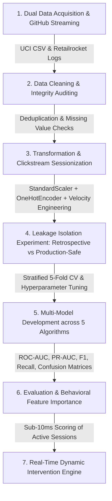

# End-to-End Predictive Analytics: Dual-Dataset E-Commerce Consumer Conversion Modeling

### Integrating Macro-Session Dynamics (UCI) and Micro-Clickstream Event Funnels (Retailrocket) with Data Leakage Isolation

[](https://colab.research.google.com/github/KshitijBhele/Predective-Analysis-CA3/blob/main/Predictive_Analysis_Project.ipynb)
[](https://www.python.org/downloads/)
[](https://opensource.org/licenses/MIT)

An industry-grade, end-to-end Predictive Analytics system engineered to predict e-commerce consumer purchasing intention during active browsing. This repository demonstrates the complete 5-stage Knowledge Discovery in Databases (KDD) process across **TWO complementary real-world datasets**: the benchmark UCI Online Shoppers Purchasing Intention dataset (12,330 sessions) and the high-throughput Retailrocket E-Commerce Clickstream dataset (2,756,101 events across 1,407,580 visitors).

---

## Project Overview & Objectives

* **Course**: Predictive Analytics / CA3 Assessment (10 Marks)
* **Author**: [Kshitij Bhele](https://github.com/KshitijBhele)
* **Academic Submission Date**: October 2026
* **Repository**: [KshitijBhele/Predective-Analysis-CA3](https://github.com/KshitijBhele/Predective-Analysis-CA3)

### Core Objectives:
1. **Real-Time Purchase Intent Prediction**: Forecast in flight whether an active browsing visitor will complete a purchase (`Revenue = True / 1`) or abandon their session (`Revenue = False / 0`) before tab closure.
2. **Empirical Data Leakage Isolation**: Expose and decouple the artificial predictive inflation caused by retrospective metrics (such as Google Analytics' `PageValues` and late-stage cart signals), building strictly production-safe early-session pipelines.
3. **High-Throughput Clickstream Sessionization**: Ingest and sessionize over 2.75 million raw clickstream events into visitor behavioral profiles, engineering signals of dwell time, exploration depth, browsing intensity, and funnel velocity.
4. **Multi-Model Benchmark Suite**: Train, tune, and evaluate **Gradient Boosting**, **Random Forest**, **Logistic Regression**, **Decision Tree**, and a **Dummy Classifier** baseline across four experimental configurations using 5-Fold Stratified Cross-Validation.
5. **Automated Business Interventions**: Implement a simulated real-time decision engine that scores live sessions and triggers automated interventions (e.g., dynamic 10% vouchers or live chat assistance) to prevent cart abandonment.

---

## Dual-Dataset Architecture

| Dimension | Dataset 1: UCI Online Shoppers | Dataset 2: Retailrocket Clickstream |
| :--- | :--- | :--- |
| **Data Modality** | Macro-level session summaries (tabular) | Micro-level event sequences (clickstream logs) |
| **Sample Size** | 12,330 sessions (12,205 deduplicated) | 2,756,101 events across 1,407,580 visitors |
| **Target Variable** | `Revenue` (Boolean: `True` / `False`) | `has_transaction` (Binary: `1` / `0`) |
| **Class Distribution** | 84.5% non-buyers, 15.5% buyers | 99.17% non-buyers, 0.83% buyers |
| **Key Telemetry** | Admin/Info/Product page counts & durations, BounceRates, ExitRates, PageValues, Month, VisitorType | Timestamp, VisitorID, Event (`view`, `addtocart`, `transaction`), ItemID, CategoryTree taxonomy |
| **Role in Study** | Tabular benchmark and testbed for `PageValues` leakage isolation | Real-world event stream sessionization & multi-stage conversion funnel modeling |

---

## KDD & Machine Learning Workflow



---

## The Feature Leakage Experiment

A foundational contribution of this research is the empirical isolation of **retrospective feature leakage**:

$$\text{PageValue} = \frac{\text{Ecommerce Revenue} + \text{Total Goal Value}}{\text{Unique Pageviews}}$$

Because `PageValues` incorporates completed transaction revenue realized at the conclusion of the session, including it creates severe retrospective leakage. Models trained with `PageValues` achieve inflated ROC-AUCs (>0.93) during offline testing but collapse when deployed in live production where transactions have not yet occurred.

### The 4 Experimental Configurations:
1. **UCI - With PageValues**: Benchmark setup containing the full feature set (leakage present).
2. **UCI - Without PageValues (Production-Safe)**: Strict early-session setup using only pre-conversion navigational metrics.
3. **Retailrocket - Early-Stage Pre-Cart**: Predicts purchase intent using only early browsing signals (`views`, `unique_items`, `duration_min`, `view_intensity`, `views_per_item`) before any items are added to cart.
4. **Retailrocket - Full-Funnel Journey**: Incorporates late-stage cart interaction signals (`cart_adds`, `cart_to_view_ratio`).

---

## Comprehensive Experimental Results & Benchmark

All models evaluated on held-out 20% test splits under 5-Fold Stratified Cross-Validation:

| Dataset | Configuration | Model | Accuracy | Precision | Recall | F1-Score | ROC-AUC | PR-AUC |
| :--- | :--- | :--- | :---: | :---: | :---: | :---: | :---: | :---: |
| **UCI Shoppers** | **With PageValues** | **Gradient Boosting** | **0.9062** | **0.7284** | **0.6387** | **0.6806** | **0.9372** | **0.7444** |
| | *(Retrospective)* | Random Forest | 0.8767 | 0.5796 | 0.7723 | 0.6622 | 0.9295 | 0.7192 |
| | | Decision Tree | 0.8480 | 0.5085 | 0.8586 | 0.6388 | 0.9232 | 0.7215 |
| | | Logistic Regression | 0.8525 | 0.5190 | 0.7880 | 0.6258 | 0.9109 | 0.6623 |
| | | Dummy Classifier | 0.7374 | 0.1636 | 0.1649 | 0.1643 | 0.5043 | 0.2296 |
| **UCI Shoppers** | **Without PageValues** | **Gradient Boosting (Precision)** | **0.8415** | **0.4528** | 0.0628 | 0.1103 | **0.7843** | **0.3564** |
| | *(Production-Safe)* | Random Forest | 0.7268 | 0.3066 | 0.5916 | 0.4039 | 0.7676 | 0.3447 |
| | | **Logistic Regression (Recall)** | **0.6346** | 0.2673 | **0.7670** | **0.3965** | **0.7509** | 0.3182 |
| | | Decision Tree | 0.7288 | 0.3103 | 0.5995 | 0.4089 | 0.7390 | 0.3862 |
| | | Dummy Classifier | 0.7374 | 0.1636 | 0.1649 | 0.1643 | 0.5043 | 0.2296 |
| **Retailrocket** | **Early Pre-Cart** | **Gradient Boosting (Best F1)** | **0.9030** | **0.7837** | **0.7901** | **0.7869** | **0.9630** | **0.8678** |
| | *(Pure Browsing)* | Random Forest (High Recall) | 0.8728 | 0.6474 | 0.9633 | 0.7743 | 0.9619 | 0.8622 |
| | | Decision Tree | 0.8735 | 0.6495 | 0.9603 | 0.7749 | 0.9597 | 0.8098 |
| | | Logistic Regression | 0.8614 | 0.6294 | 0.9441 | 0.7553 | 0.9195 | 0.7079 |
| | | Dummy Classifier | 0.6588 | 0.2386 | 0.2308 | 0.2347 | 0.5075 | 0.3219 |
| **Retailrocket** | **Full-Funnel Journey** | **Gradient Boosting** | **0.9757** | **0.9544** | **0.9377** | **0.9460** | **0.9915** | **0.9620** |
| | *(With Cart Actions)* | Random Forest | 0.9710 | 0.9255 | 0.9484 | 0.9368 | 0.9914 | 0.9630 |
| | | Decision Tree | 0.9653 | 0.8962 | 0.9578 | 0.9260 | 0.9886 | 0.9574 |
| | | Logistic Regression | 0.9515 | 0.8765 | 0.9147 | 0.8952 | 0.9822 | 0.9292 |
| | | Dummy Classifier | 0.6588 | 0.2386 | 0.2308 | 0.2347 | 0.5075 | 0.3219 |

### Key Production Takeaways:
1. **The Production Champion on UCI**: Cost-sensitive **Logistic Regression (Without PageValues)** achieves an ROC-AUC of **0.7509** and captures **76.70% of converting shoppers** early in the session, functioning as the ideal early-warning trigger for real-time engagement.
2. **Pre-Cart Intent on Retailrocket**: **Gradient Boosting (Pre-Cart)** achieves an exceptional **0.9630 ROC-AUC** and **79.01% Recall** using strictly browsing signals (`views_per_item`, `duration_min`, `view_intensity`) *before* any cart addition occurs.
3. **The Data Leakage Penalty**: Removing retrospective `PageValues` reduces UCI Gradient Boosting ROC-AUC from 0.9372 to 0.7843, proving that 15 percentage points of offline AUC were purely attributable to leakage.

---

## Real-Time Inference & Automated Dynamic Intervention

The system includes an operational decision engine capable of scoring active sessions in under 10 milliseconds:

```text
Clickstream Telemetry Stream  -->  StandardScaler (<5ms)  -->  Model Inference (<10ms)  -->  Dynamic Action
```

* **Case 1 (UCI Macro Visitor)**: A visitor inspecting 30 product pages over 980s in November receives a predicted purchase probability of **38.87%** ($P \ge 0.35$).  
  $\rightarrow$ **Dynamic Action**: Deploys an instant 10% checkout discount voucher overlay to secure the transaction.
* **Case 2 (Retailrocket Micro Visitor)**: A visitor with 12 product views across 7 items over 8.5 min receives a pre-cart score of **20.21%** ($0.15 \le P < 0.30$).  
  $\rightarrow$ **Dynamic Action**: Displays related trending items and a free-shipping threshold badge to nudge cart addition.

---

## How to Run the Project

### Option 1: Run via Python Terminal (Instant Execution)
1. Clone the repository:
   ```bash
   git clone https://github.com/KshitijBhele/Predective-Analysis-CA3.git
   cd Predective-Analysis-CA3
   ```
2. Install dependencies:
   ```bash
   pip install -r requirements.txt
   ```
3. Run the complete dual-dataset pipeline:
   ```bash
   python run_analysis.py
   ```
   *Executes data loading, sessionization, 5-fold cross-validation across all 20 models, real-time inference, and saves high-resolution charts and metric tables into `outputs/`.*

### Option 2: Run in Google Colab or Jupyter Notebook
1. Click the **[Open in Colab](https://colab.research.google.com/github/KshitijBhele/Predective-Analysis-CA3/blob/main/Predictive_Analysis_Project.ipynb)** badge at the top of this repository.
2. Select **Runtime -> Run all** to execute the notebook end-to-end. The notebook automatically streams the datasets and executes all 21 modular steps.

### Option 3: Regenerate Academic Report & Presentation Deck
To regenerate the Word report and PowerPoint presentation:
```bash
python generate_report.py
python generate_presentation.py
```

---

## Repository Structure

```text
Predective-Analysis-CA3/
├── Predictive_Analysis_Project.ipynb                  # Primary Jupyter Notebook (Dual-Dataset End-to-End)
├── run_analysis.py                                    # Standalone Python pipeline (Dual-Dataset)
├── build_notebook.py                                  # Modular notebook compilation script
├── generate_report.py                                 # Academic report generator (docx)
├── generate_presentation.py                           # Executive slide deck generator (pptx)
├── Predictive_Analytics_CA3_Report.docx               # 6-Chapter academic & technical project report
├── Predictive_Analytics_CA3_Presentation.pptx         # 12-Slide individual presentation deck
├── online_shoppers_intention.csv                      # Dataset 1: UCI Online Shoppers (CSV)
├── online+shoppers+purchasing+intention+dataset.zip   # Dataset 1 archive
├── archive (1)/                                       # Dataset 2: Retailrocket Recommender Dataset
│   ├── events.csv                                     # 2.75M raw clickstream events
│   ├── category_tree.csv                              # Category taxonomy (1,669 categories)
│   ├── item_properties_part1.csv                      # Item properties metadata
│   └── item_properties_part2.csv                      # Item properties metadata
├── requirements.txt                                   # Python library dependencies
├── README.md                                          # Complete project documentation
└── outputs/                                           # Generated evaluation plots & benchmarks
    ├── eda_analysis_uci.png                           # UCI exploratory analysis
    ├── eda_analysis_retailrocket.png                  # Retailrocket funnel & clickstream EDA
    ├── evaluation_curves_uci.png                      # UCI ROC & PR curves (With vs Without PageValues)
    ├── evaluation_curves_retailrocket.png             # Retailrocket ROC & PR curves (Pre-Cart vs Full)
    ├── feature_importances_dual.png                   # Side-by-side feature importance comparisons
    └── model_performance_summary.csv                  # Complete 20-model benchmark table
```

---

## References & Academic Attribution

1. **UCI Dataset**: Sakar, C. O., Polat, S. O., Katircioglu, M., & Kastro, Y. (2019). Real-time prediction of online shoppers' purchasing intention using multilayer perceptron and LSTM recurrent neural networks. *Neural Computing and Applications*, 31(10), 6893-6908.
2. **Retailrocket Dataset**: Retailrocket. (2016). Retailrocket recommender system dataset. *Kaggle E-Commerce Dataset*.
3. **KDD Methodology**: Fayyad, U., Piatetsky-Shapiro, G., & Smyth, P. (1996). From data mining to knowledge discovery in databases. *AI Magazine*, 17(3), 37-54.
4. **Data Leakage in Predictive Mining**: Kaufman, S., Rosset, S., Perlich, C., & Stitelman, O. (2012). Leakage in data mining: Formulation, detection, and avoidance. *ACM Transactions on Knowledge Discovery from Data (TKDD)*, 6(4), 1-21.
5. **Class Imbalance**: Chawla, N. V., Bowyer, K. W., Hall, L. O., & Kegelmeyer, W. P. (2002). SMOTE: Synthetic minority over-sampling technique. *Journal of Artificial Intelligence Research*, 16, 321-357.
