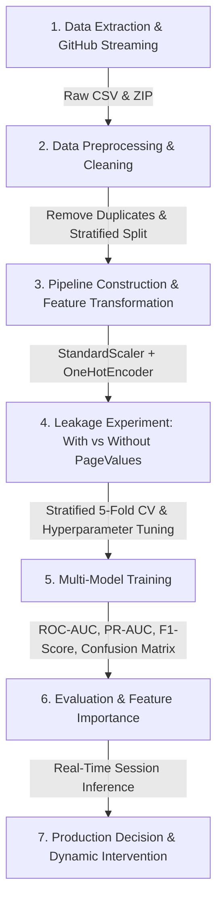

# Online Purchase Intention Prediction Using Machine Learning

[](https://colab.research.google.com/github/KshitijBhele/Predective-Analysis-CA3/blob/main/Predictive_Analysis_Project.ipynb)
[](https://www.python.org/downloads/)
[](https://opensource.org/licenses/MIT)

An end-to-end Predictive Analytics system engineered to predict e-commerce visitor purchase intent during active browsing sessions. This repository includes complete data preprocessing, automated Exploratory Data Analysis (EDA), machine learning modeling, and an empirical investigation into data leakage caused by the retrospective `PageValues` metric.

---

## Direct GitHub Dataset Streaming

The dataset for this project is hosted directly in this GitHub repository and loaded seamlessly by both the standalone Python script and the Jupyter Notebook:

- **Raw CSV URL**: [online_shoppers_intention.csv](https://raw.githubusercontent.com/KshitijBhele/Predective-Analysis-CA3/main/online_shoppers_intention.csv)
- **Raw ZIP Archive URL**: [online+shoppers+purchasing+intention+dataset.zip](https://raw.githubusercontent.com/KshitijBhele/Predective-Analysis-CA3/main/online%2Bshoppers%2Bpurchasing%2Bintention%2Bdataset.zip)

### How Code Connects to GitHub:
Both `run_analysis.py` and `Predictive_Analysis_Project.ipynb` connect directly to GitHub:
```python
import pandas as pd

GITHUB_CSV_URL = "https://raw.githubusercontent.com/KshitijBhele/Predective-Analysis-CA3/main/online_shoppers_intention.csv"

# Directly stream the dataset from GitHub
df = pd.read_csv(GITHUB_CSV_URL)
print(f"Loaded dataset directly from GitHub: {df.shape}")
```
*(If offline or running locally without internet access, the code automatically falls back to local files without crashing).*

---

## Project Overview & Objectives

* **Course / Domain**: Predictive Analytics / Machine Learning
* **Author**: [Kshitij Bhele](https://github.com/KshitijBhele)
* **Repository**: [KshitijBhele/Predective-Analysis-CA3](https://github.com/KshitijBhele/Predective-Analysis-CA3)

### Core Objectives:
1. **Real-Time Intent Prediction**: Classify whether a website visitor will complete a transaction (`Revenue = True`) or abandon their session (`Revenue = False`).
2. **Data Leakage Isolation**: Investigate the predictive inflation caused by `PageValues` (a retrospective Google Analytics variable incorporating transaction value), and build a production-safe pipeline that predicts conversions using genuine early-session behavioral signals.
3. **Multi-Model Benchmark**: Train, tune, and evaluate **Gradient Boosting**, **Random Forest**, **Logistic Regression**, **Decision Tree**, and a **Dummy Classifier** baseline using 5-Fold Stratified Cross-Validation.
4. **Actionable Business Interventions**: Output real-time conversion probability scores to trigger targeted engagement (dynamic discounts, live chat assistance) before cart abandonment occurs.

---

## KDD & Machine Learning Workflow



---

## Dataset Description

* **Source**: [UCI Machine Learning Repository - Online Shoppers Purchasing Intention Dataset](https://archive.ics.uci.edu/dataset/468/online+shoppers+purchasing+intention+dataset)
* **Total Instances**: 12,330 sessions (12,205 unique sessions post-cleaning).
* **Target Feature**: `Revenue` (Boolean: `True` if purchase completed, `False` otherwise).
* **Key Attributes**:
  * **Browsing Behavior**: `Administrative`, `Administrative_Duration`, `Informational`, `Informational_Duration`, `ProductRelated`, `ProductRelated_Duration`.
  * **Navigation & Engagement**: `BounceRates`, `ExitRates`, `PageValues`.
  * **Temporal & Demographic**: `SpecialDay`, `Month`, `OperatingSystems`, `Browser`, `Region`, `TrafficType`, `VisitorType` (`New_Visitor`, `Returning_Visitor`, `Other`), `Weekend`.

---

## Experimental Results & Comparison

Evaluated on a held-out 20% test split ($n = 2,441$ sessions):

| Configuration | Model | Accuracy | Precision | Recall | F1-Score | ROC-AUC | PR-AUC |
| :--- | :--- | :---: | :---: | :---: | :---: | :---: | :---: |
| **With PageValues** | **Gradient Boosting** | **0.906** | **0.728** | **0.639** | **0.681** | **0.937** | **0.744** |
| *(Retrospective Signal)* | Random Forest | 0.898 | 0.682 | 0.657 | 0.669 | 0.929 | 0.718 |
| | Logistic Regression | 0.853 | 0.519 | 0.788 | 0.626 | 0.911 | 0.662 |
| | Decision Tree | 0.848 | 0.508 | 0.861 | 0.639 | 0.912 | 0.509 |
| | Dummy Classifier | 0.730 | 0.155 | 0.154 | 0.155 | 0.500 | 0.156 |
| **Without PageValues** | **Gradient Boosting** | **0.841** | **0.453** | **0.063** | **0.110** | **0.784** | **0.356** |
| *(Production-Safe)* | Random Forest | 0.835 | 0.392 | 0.076 | 0.127 | 0.768 | 0.350 |
| | **Logistic Regression** | **0.729** | **0.315** | **0.626** | **0.419** | **0.746** | **0.345** |
| | Decision Tree | 0.825 | 0.333 | 0.115 | 0.171 | 0.702 | 0.224 |
| | Dummy Classifier | 0.724 | 0.164 | 0.165 | 0.164 | 0.504 | 0.230 |

### Key Findings & Production Recommendation:
* **The `PageValues` Leakage**: While including `PageValues` inflates ROC-AUC to **0.937**, it relies on completed transaction values unavailable during active live browsing.
* **Production Winner**: **Logistic Regression (Without PageValues)** achieves a robust ROC-AUC of **0.746** and captures **62.6% of converting visitors** (Recall = 0.626), providing optimal real-time intervention performance.

---

## How to Run the Project

### Option 1: Run Locally via Python Terminal
1. Clone the repository:
   ```bash
   git clone https://github.com/KshitijBhele/Predective-Analysis-CA3.git
   cd Predective-Analysis-CA3
   ```
2. Install dependencies:
   ```bash
   pip install -r requirements.txt
   ```
3. Run the end-to-end analysis pipeline:
   ```bash
   python run_analysis.py
   ```
   *This automatically streams the dataset from GitHub, trains models, performs 5-fold cross validation, computes evaluation metrics, runs real-time inference, and saves visual plots to the `outputs/` folder.*

### Option 2: Run in Google Colab / Jupyter Notebook
1. Click the **[Open in Colab](https://colab.research.google.com/github/KshitijBhele/Predective-Analysis-CA3/blob/main/Predictive_Analysis_Project.ipynb)** badge at the top of this README.
2. Select **Runtime -> Run all** to execute all cells end-to-end. The notebook automatically connects to the GitHub repository to load the dataset.

---

## Project Structure

```text
Predective-Analysis-CA3/
├── Predictive_Analysis_Project.ipynb                  # Primary Jupyter Notebook with full analysis
├── run_analysis.py                                    # Standalone Python pipeline
├── online_shoppers_intention.csv                      # Raw dataset (CSV)
├── online+shoppers+purchasing+intention+dataset.zip   # Original dataset archive
├── requirements.txt                                   # Python dependencies
├── .gitignore                                         # Git ignore specifications
├── README.md                                          # Project documentation
├── Predictive_Analytics_CA3_Presentation.pptx         # Presentation slides
├── Predictive_Analytics_CA3_Report.docx               # Academic project report
└── outputs/                                           # Saved evaluation plots & metrics
    ├── eda_analysis.png
    ├── evaluation_curves.png
    ├── feature_importances.png
    └── model_performance_summary.csv
```

---

## References & Attribution

* **Dataset**: Sakar, C.O., Polat, S.O., Katircioglu, M. et al. *Real-time prediction of online shoppers' purchasing intention using multilayer perceptron and support vector machines.* Neural Computing and Applications 31, 6893–6908 (2019).
* **UCI Repository**: [Online Shoppers Purchasing Intention Dataset](https://archive.ics.uci.edu/dataset/468/online+shoppers+purchasing+intention+dataset)
